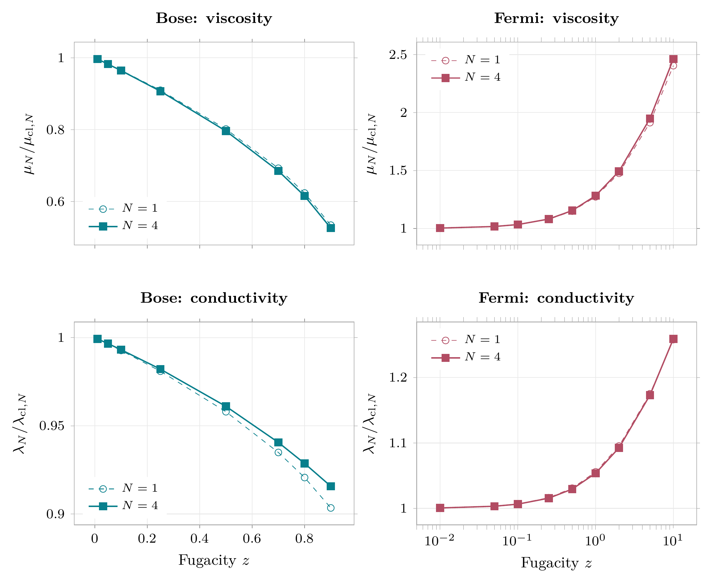
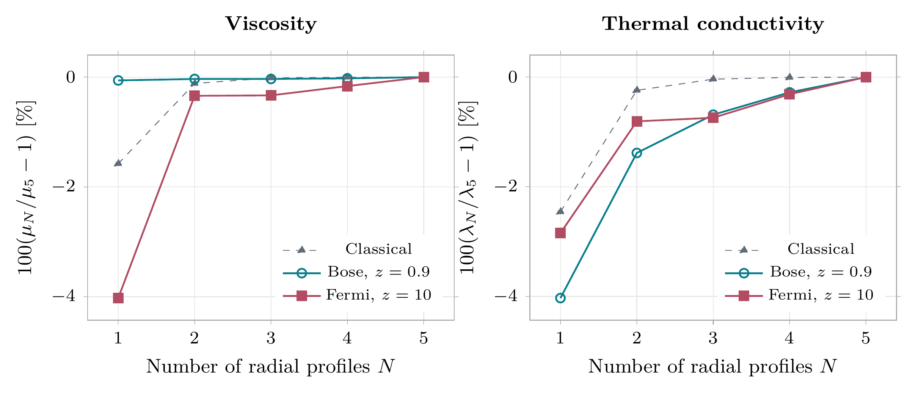
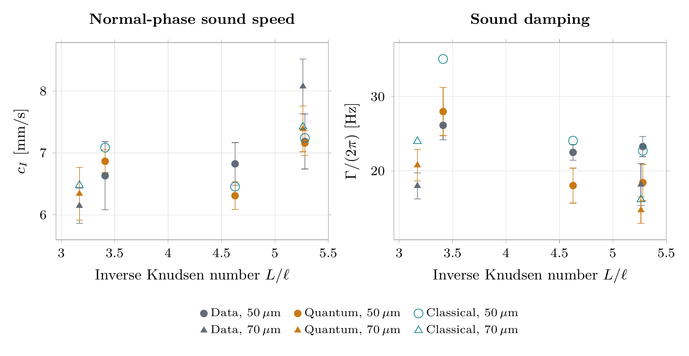

# Quantum Gas Transport

[](https://github.com/LvSkywalker/Quantum-Gas-Transport-Solver/actions/workflows/tests.yml)

**A C++17 Galerkin solver for viscosity, thermal conductivity and linear relaxation in quantum gases.**

Starting from the linearized Uehling--Uhlenbeck collision operator, this project computes transport coefficients for classical, Bose and Fermi gases. Collision integrals determine the coefficients and relaxation rates; no relaxation time is fitted. The implementation combines conservation-constrained Sonine--Laguerre bases, multidimensional Gaussian quadrature and Eigen linear algebra.

[](docs/technical_note/figures/transport.pdf)

**[Technical note (PDF)](docs/technical_note/main.pdf)** · **[Numerical method](docs/METHODS.md)** · **[Verification and convergence](docs/VALIDATION.md)** · **[Reproduction guide](docs/REPRODUCIBILITY.md)**

## What the project demonstrates

- A collision-bracket integral reduced from **8 to 5 variables** using rotational symmetry and evaluated with cached collision-pair features.
- **36 transport calculations** across 18 statistical states, comparing quantum and classical coefficients at the same basis size, N=1 and N=4.
- A separate evaluation of published **one-profile** variational integrals: maximum discrepancy below **0.0031%** across five test states.
- Basis refinement through **N=5** and independent quadrature refinement. The largest N=4 to N=5 coefficient change in the displayed cases is **0.3134%**.
- Homogeneous linear relaxation from a **generalized symmetric eigenproblem**, with entropy decay and an integrated-response check against steady transport.
- **24 automated test groups**, plus command-line smoke tests configured with CTest. GitHub Actions is configured for Linux/macOS Debug and Release builds and Linux sanitizers.

These figures refer to the saved production calculations in `results/cpp/`. See the [evidence table](docs/VALIDATION.md#evidence-behind-the-numbers) for benchmark definitions and refinement settings.

## Build and run

Requirements: a C++17 compiler and CMake >=3.16. Eigen 3.4.0 and nlohmann/json 3.11.3 are bundled, so building the solver requires no downloads or Python installation.

```sh
cmake -S . -B build -DCMAKE_BUILD_TYPE=Release
cmake --build build --parallel 2
ctest --test-dir build --output-on-failure

build/qtransport transport --statistics bose --fugacity 0.5 --basis 4 \
  --radial 32 --angular 24 --azimuth 24 --output runs/bose-z0.5-n4.json
```

The output includes `viscosity`, `conductivity`, the Galerkin matrices, matching and conservation diagnostics, and homogeneous relaxation curves. Run `build/qtransport --help` for commands and defaults. Without CMake, use `sh build.sh`, then `build/qtransport test --root .`.

To recompute the transport scan, convergence study and figures:

```sh
build/qtransport reproduce --root .
build/qtransport figures --root .
```

Open `results/cpp/index.html` in a browser for the lightweight C++ diagnostic plots. The reproduction command refreshes the corresponding saved outputs. The README displays high-resolution exports of the technical note's vector figures; click either figure to open its PDF. Their [rebuild instructions](docs/REPRODUCIBILITY.md#readme-figures) use the same saved numerical results. The [examples](examples/README.md) also show a single classical benchmark, the Wu reference calculation and kernel scaling.

## Mathematical workflow

For a matched trial basis, Galerkin projection gives

```text
M_mn = [Phi_m, Phi_n]                 collision bracket matrix
d_m  = integral w Phi_m J dv          projected transport source
M alpha = d                          steady transport solve
H dc/dt = -M c                       homogeneous linear relaxation
H_mn = integral w Phi_m Phi_n dv      weighted Gram matrix
```

The positive collision bracket permits Cholesky solves and supplies the dissipation identity. Thermal profiles are adjusted to satisfy momentum matching under the quantum weight; they need not be mutually orthogonal. N counts radial basis functions, while the Chapman--Enskog expansion remains first order in gradients.

[](docs/technical_note/figures/convergence.pdf)

The reference in this figure is each curve's own N=5 value. Its zero endpoint follows from normalization. [Details and limitations](docs/VALIDATION.md).

## Model and applications

The core model describes normal, dilute, nonrelativistic gases near local equilibrium with elastic binary collisions. The default kernel is `B = |v-v1| d^2/4`; isotropic power laws `B = C |v-v1|^gamma`, with C>0 and gamma>-3, are also supported. Code units are n=m=kBT=1. The [method note](docs/METHODS.md) gives dimensional restoration factors.

Two applications reuse the transport model:

- A projected transverse kinetic mode recovers the steady viscosity in the long-wavelength limit. Its angular truncation limits finite-wave-number predictions.
- A comparison with Hilker et al.'s normal-Bose sound measurements combines transport with Hartree--Fock thermodynamics and linearized fluid equations.

### Experimental application and classical-transport control

[](docs/technical_note/figures/hilker.pdf)

For five observations selected by inverse Knudsen number **L/ell >= 3**, the quantum-transport calculation gives a sound-speed normalized RMS residual of **1.031** and damping deviations from **-20.9% to +15.5%**, without fitting to the sound measurements. However, **classical transport with the same Hartree--Fock thermodynamics gives almost identical RMS agreement**:

| Normalized RMS residual | Quantum transport + HF | Classical transport + HF |
|---|---:|---:|
| Sound speed | 1.031 | 1.040 |
| Sound damping | 2.654 | 2.648 |

Each residual is divided by its reported measurement uncertainty before taking the RMS. These five observations do **not** demonstrate a clear improvement in experimental agreement from quantum transport corrections. The control changes viscosity and conductivity only; it is not a fully classical thermodynamic model. [Method, residuals and data attribution](docs/APPLICATIONS.md#classical-transport-control).

### Limitations

The model excludes condensation, superfluidity and nonlinear spatial evolution. The Fermi solver is an effective single-distribution model; absolute coefficients for a particular spin mixture require its scattering conventions. Basis and quadrature changes diagnose convergence rather than bound continuum error. The one-profile reference check targets Wu's variational integrals, not his full Fourier collision solver. The sound comparison adds thermodynamic and hydrodynamic assumptions; its RMS values are descriptive and do not propagate input uncertainty or covariance. Projected shear modes retain only selected angular sectors.

## Repository map

| Path | Role |
|---|---|
| `src/numerics.cpp` | Quadrature construction, equilibrium and matched polynomials |
| `src/collisions.cpp` | Five-variable brackets and separate four-variable Wu reference integrals |
| `src/solver.cpp` | Cholesky transport solves and homogeneous relaxation |
| `src/dynamics.cpp` | Projected shear modes and longitudinal fluid modes |
| `src/thermodynamics.cpp` | Normal-Bose thermodynamics and physical units |
| `tests/` | Physics checks and frozen regression fixtures with provenance |
| `results/cpp/` | Production data, settings, diagnostics and generated SVG figures |
| `docs/assets/` | High-resolution exports of the technical note's figures for Markdown |
| `docs/technical_note/` | Standalone derivation, results, LaTeX sources and figure data |
| `references/hilker2022/` | Published experimental data and attribution |
| `third_party/` | Pinned dependencies and their upstream licenses |

## Scientific references and attribution

The project implements established kinetic theory and numerical techniques. Its contribution is the C++ implementation, reproducible verification and applications to the stated model.

1. Uehling & Uhlenbeck, *Transport Phenomena in Einstein--Bose and Fermi--Dirac Gases. I* (1933), [DOI](https://doi.org/10.1103/PhysRev.43.552).
2. Wu, *A fast spectral method for the Uehling--Uhlenbeck equation for quantum gas mixtures* (2018), [arXiv v1](https://arxiv.org/abs/1810.03090v1), Eq. (50), used for the one-profile benchmark.
3. Hilker et al., *First and Second Sound in a Compressible 3D Bose Fluid* (2022), [paper](https://doi.org/10.1103/PhysRevLett.128.223601) and [data](https://doi.org/10.17863/CAM.83837).

Author: Luigi Di Gregorio. Original project code and documentation: [MIT license](LICENSE). Bundled libraries and external datasets retain their own terms; see [third-party notices](THIRD_PARTY_NOTICES.md). Software citation metadata is in [CITATION.cff](CITATION.cff).
