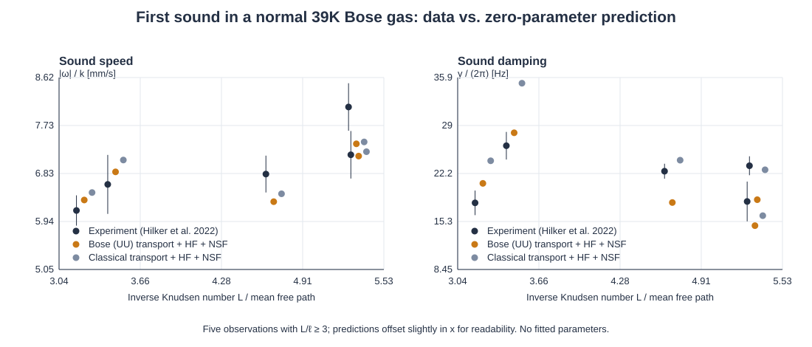
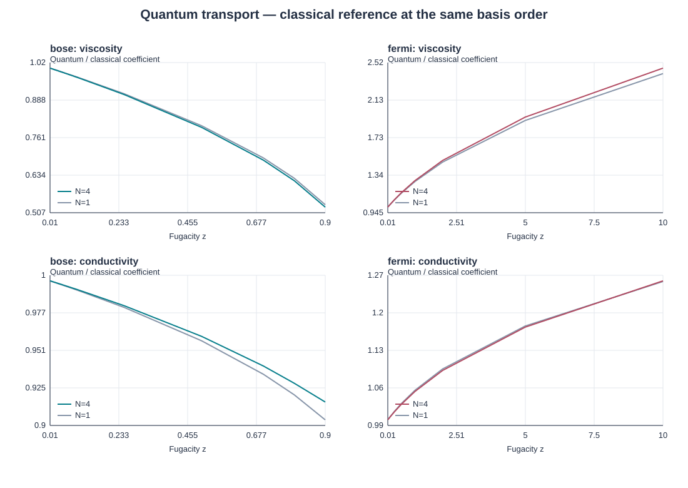

# Quantum Gas Transport

A C++17 solver for the viscosity and thermal conductivity of dilute Bose, Fermi and classical gases, computed from the linearized Uehling–Uhlenbeck (quantum Boltzmann) equation, and a zero-parameter comparison with sound measurements in a normal ³⁹K Bose gas.



## What it does

1. **Collision integrals.** The Chapman–Enskog integral equations of Uehling and Uhlenbeck (1933) are solved with a Galerkin method on Sonine–Laguerre radial profiles. The collision brackets are integrated directly: an 8-dimensional integral reduced to 5 dimensions by rotational symmetry and evaluated with Gauss–Laguerre/Gauss–Legendre quadrature. Bose enhancement and Pauli blocking enter through the (1 ± f) factors; no relaxation time is assumed.
2. **Transport coefficients.** Shear viscosity η and thermal conductivity κ as functions of fugacity, for hard-sphere and general power-law kernels B = C|v − v₁|^γ, with basis and quadrature convergence studies.
3. **Dynamics.** Homogeneous linear relaxation and a transverse shear wave from the projected kinetic equation; its long-wavelength decay recovers the steady viscosity.
4. **Experiment.** The coefficients, with Hartree–Fock thermodynamics and linearized Navier–Stokes–Fourier modes, predict the speed and damping of first sound measured by [Hilker et al., PRL 128, 223601 (2022)](https://doi.org/10.1103/PhysRevLett.128.223601) using their [open data](https://doi.org/10.17863/CAM.83837). Nothing is fitted.



## Validation

| Check | Result |
|---|---|
| Classical first Sonine approximation | η₁ = 5/(16√π), κ₁ = 75/(64√π) in code units, to 1e-11 |
| Second Sonine approximation, closed forms | 1 + 3/202, 1 + 1/44 (hard spheres, γ = 1); 1 + 3/190, 1 + 1/40 (γ = −1) |
| Hard-sphere convergence, N = 5 | 1.016028 and 1.025197 × first approximation (exact: 1.016034, 1.025218) |
| Quantum one-profile results vs. Wu, Eq. (50), separate quadrature | max. discrepancy 0.003% (5 cases) |
| Collision geometry | momentum and energy conserved to round-off |
| Sound-mode algebra vs. published theory curve | within 0.08% |

## Comparison with experiment

Five observations with L/ℓ ≥ 3 (hydrodynamic regime), fugacity z = 0.33–0.78:

- **Sound speed:** agrees within experimental errors (RMS residual = 1.0 σ). The speed is set mostly by thermodynamics.
- **Damping:** agrees within −21% to +16% (RMS residual = 2.6 σ). This is the part that depends on η and κ.
- **Quantum vs. classical:** Bose statistics lowers η by 13–37% and the predicted damping by 9–25% at these points. Classical transport fits equally well (same RMS, opposite average sign), so these five points do not discriminate between the two.

Details, derivations and uncertainties: [docs/HILKER_ANALYSIS.md](docs/HILKER_ANALYSIS.md).

## Build and run

Requires a C++17 compiler and CMake ≥ 3.16. Eigen 3.4.0 and nlohmann/json 3.11.3 are bundled (header-only), so no downloads are needed.

```sh
cmake -S . -B build -DCMAKE_BUILD_TYPE=Release
cmake --build build --parallel 2
ctest --test-dir build --output-on-failure

build/qtransport transport --statistics bose --fugacity 0.5 --basis 4   # one calculation
build/qtransport reproduce --root .    # transport sweep, convergence, benchmarks, dynamics
build/qtransport hilker --root .       # comparison with the experiment
build/qtransport figures --root .      # SVG figures and results/index.html
```

`sh build.sh` builds without CMake. The full reproduction takes about a minute on a laptop.

## Layout

| Path | Content |
|---|---|
| `src/numerics.cpp` | Gaussian quadratures, equilibria, matching conditions |
| `src/collisions.cpp` | 5-D collision brackets; independent Wu benchmark |
| `src/solver.cpp` | Galerkin solves, homogeneous relaxation |
| `src/dynamics.cpp` | Shear wave, longitudinal sound modes |
| `src/thermodynamics.cpp` | Hartree–Fock thermodynamics of the normal Bose gas, data input |
| `src/workflows.cpp`, `src/figures.cpp` | Reproduction runs and SVG figures |
| `tests/tests.cpp` | Analytic limits, conservation, benchmarks, regressions |
| `docs/` | [Method](docs/METHODS.md) and [experimental comparison](docs/HILKER_ANALYSIS.md) |
| `references/hilker2022/` | Original data archive (CC BY 4.0) and attribution |

## Limitations

Normal phase only: no condensate or superfluidity. Isotropic scattering with an energy-independent cross section. Fermi results use a single effective distribution and are not absolute predictions for a specific spin mixture. The sound comparison assumes hydrodynamics and homogeneous Hartree–Fock thermodynamics, so finite-Knudsen and boundary effects are not included.

## References

1. E. A. Uehling and G. E. Uhlenbeck, *Transport Phenomena in Einstein–Bose and Fermi–Dirac Gases. I*, Phys. Rev. 43, 552 (1933).
2. L. Wu, *A fast spectral method for the Uehling–Uhlenbeck equation for quantum gas mixtures*, J. Comput. Phys. (2019), [arXiv:1810.03090](https://arxiv.org/abs/1810.03090).
3. T. A. Hilker et al., *First and Second Sound in a Compressible 3D Bose Fluid*, PRL 128, 223601 (2022); data: [doi:10.17863/CAM.83837](https://doi.org/10.17863/CAM.83837), CC BY 4.0.
4. S. Chapman and T. G. Cowling, *The Mathematical Theory of Non-Uniform Gases*, Cambridge University Press.

## License

MIT for the project code (see `LICENSE`). Bundled libraries keep their own licenses (`third_party/`); the experimental data are CC BY 4.0 (`references/hilker2022/`).
